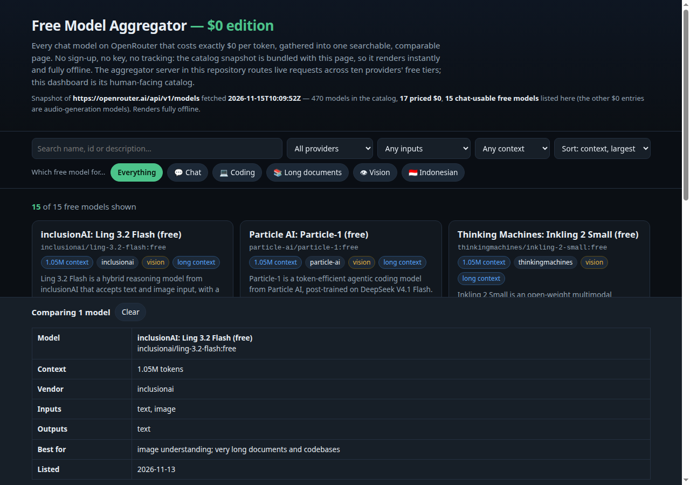

# free-model-aggregator

One aggregator over the free tiers of ten AI providers. The server in this repository reads the
trial brief — the provider directory, the sealed quality table and the workload manifest — probes
every provider's catalog in its own wire, and then serves OpenAI Chat Completions and Anthropic
Messages requests (JSON and server-sent events) from whichever free model serves them best.

**How it routes.** Every request is normalized to one canonical form (system text, turns, tools,
output cap, stop strings, images, JSON mode), so a request that arrives on one wire can be served
by a provider speaking another: OpenAI, Anthropic and Gemini wires are all implemented, in both
directions. Candidates are the free models that meet the request's requirements, ordered by the
quality table's rating. Providers are always called non-streaming — the answer's stop reason and
usage are then the provider's own — and client streams are synthesized from the whole answer in
the client's event shapes.

**How it fails over.** A provider's per-trial budget and its scheduled refusals are not in the
brief, so a refusal (402, 429 or 5xx) retries the same model once — a scheduled refusal consumes
its slot and the next call usually lands — then moves down the rating order. A provider that has
failed twice running after several counted calls is treated as probably spent: it keeps its place
in the order but gets no retry until it answers again, so a dead provider stops taxing every later
request twice. Every choice derives from the brief and the providers' answers alone — no wall
clock, no randomness — so a replay makes the same calls and leaves the same state.

**Practice results** (the kit's own env and scorer, all three practice trials): score **99** on
each — quality 99 (the structural ceiling: the top model's budget runs out before the workload
does), served 100, wire 100, failover 100, catalog 100; 20 of 20 requests valid; 34–43 upstream
calls per trial. A repeated run leaves a byte-for-byte identical state export.

## The dashboard

`dashboard/` is the human-facing half: every chat model on OpenRouter priced at exactly $0 per
token — 15 of them in the bundled snapshot (470 models in the catalog, 17 priced $0, two of which
are audio-generation models) — with fast search, provider / vision / context filters, sorting, a
three-model comparison view, per-model details, and a “which free model for…” task helper (chat,
coding, long documents, vision, Indonesian). It is fully static and renders with no network: open
`dashboard/index.html` or serve the folder.

## Layout

- `main.ts` — the server: brief, probes, catalog, registration, routing, failover, `/work` polling.
- `lib/brief.ts` — the brief's three documents and the catalog builder.
- `lib/wires.ts` — the canonical request/answer form and every wire translation.
- `dashboard/` — the static free-model catalog (snapshot data in `data.js`).
- `BUILD_NOTES.md` — data sources, verification results and the entry's open items.

Run it the way the trial does: `MAKEFUN_ENV_URL=… MAKEFUN_PROMPT_FILE=… node main.ts`, or
`node main.ts --list` to print the catalog document it registers (outside a trial: `{"providers":[]}`).
Node 22+, standard library only — nothing to install.

## License

MIT — see `LICENSE`.
